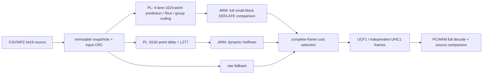

# 最终系统与接口

一份Overlay、HP0与HP1两路DMA，各引擎两个CMA槽，声明数组共492448字节，页映射实际512KiB。LZ差分、校验、匹配及令牌输出在PL；动态Huffman在ARM。原1024点候选与大块候选每次都完整计算，不按历史预测跳过候选。

每个任务1至8192点，原生拆为至多8个1024点小块；比较原小块混合帧完整长度之和、一个大块DEFLATE帧、一个原始帧。平局保留顺序固定。原生胜出时可发多帧，最终序号按实际输出递增，而非直接复用内部硬件任务序号。

runtime/board/unified_system.py调度与runtime/board/unified_drivers.py保持最终实现；tools/app_config.py只改变提交版的本地保存目录、示例来源及独立板端部署，不改变候选算法。完整源码依赖即使只被继承的驱动类引用也保留；旧实验结果和无关部署脚本不作为运行前提。
